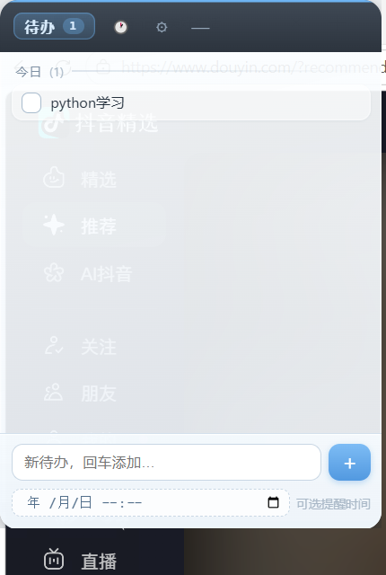
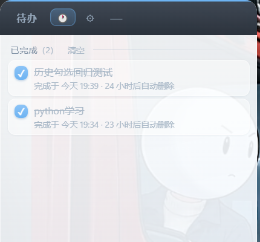
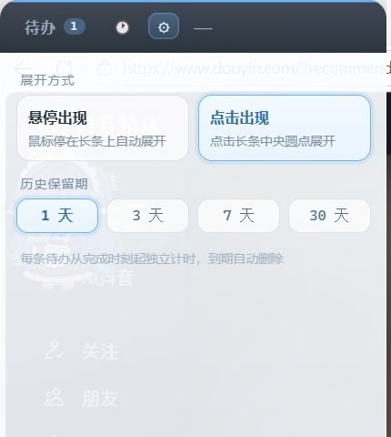

# 📌 edge-todo · 贴边待办

> 桌面贴边待办悬窗 —— 半透明长条吸附屏幕四边，悬停或点击滑出待办面板，到点提醒 + 番茄钟。
> Electron + 原生 JavaScript，无框架、无运行时依赖，数据全部存本地。


| 待办面板 | 历史 | 设置 | 贴边长条 |
|:-:|:-:|:-:|:-:|
|  |  |  |  |

## ✨ 功能特性

- **贴边吸附**：长条拖到哪吸到哪，四边（上/下/左/右）自动吸附，支持多显示器；分辨率变化自动回安全位
- **晨雾玻璃质感**：长条与面板均为半透明，透出桌面；贴边侧圆角收窄 + 雾蓝辉光细线
- **两种展开方式**（可在设置切换）：鼠标悬停长条自动滑出，或点击长条圆点展开
- **待办管理**：按「今日 / 以后」分组、双击行内编辑、过期待办一键「改明天」
- **到点提醒**：30 秒轮询（精度 ±30 秒），系统通知 + 长条闪烁 + 面板行高亮，点通知直达面板
- **历史留存**：完成的待办进入历史视图，**每条从各自完成时刻独立倒计时**，保留 1 / 3 / 7 / 30 天（可设置），到期自动删除；历史里点 ✓ 可取消完成、条目回到待办
- **番茄钟**：条目上点 ▶ 开始 25 分钟专注（主进程计时，收起面板不丢），结束弹通知并累计 🍅
- **全局快捷键 / 托盘**：Alt+Q 呼出或收起；托盘菜单含开机自启开关
- **数据本地化**：`data/todos.json` + `data/settings.json`，重启不丢、不上传

## 🚀 快速开始

前置：Windows 10/64 位 + Node.js ≥ 18。

```bash
git clone https://github.com/Sunpigig/edge-todo.git
cd edge-todo
npm install
npm start
```

或者安装完依赖后**双击 [启动器.vbs](启动器.vbs)**：无控制台窗口静默启动；未装依赖会弹窗提示；重复双击安全（内置单实例锁，只会唤起已有实例）。

## ⌨️ 使用

| 操作 | 方式 |
|---|---|
| 展开面板 | 悬停长条约 0.3 秒 / 点击圆点（可在 ⚙ 设置切换）/ **Alt+Q** / 单击托盘图标 |
| 收回面板 | 鼠标移开 0.5 秒自动收回 / Alt+Q / 头部「—」 / Esc |
| 切换视图 | 头部三页签：**待办 / 🕐历史 / ⚙设置**，当前项高亮，点「待办」一键返回 |
| 移动 / 换边 | 按住长条（或面板头部空白处）拖动，松手自动吸附最近边；位移过小视为点击，不误触 |
| 添加待办 | 底部输入回车或点「＋」；第二行可选提醒时间 |
| 完成 / 取消完成 | 列表里点方框勾选；历史里点 ✓ 取消完成、回到待办 |
| 编辑 / 顺延 | 双击文字直接改；过期待办有「改明天」 |
| 番茄钟 | 悬停条目点 ▶ / ■ |
| 退出 | 托盘右键 → 退出（Alt+F4 已拦截防误关） |

## 🧱 项目结构

```
edge-todo/
├─ main.js            主进程：窗口/吸附/手动拖动/托盘/快捷键/提醒/番茄钟/历史清理
├─ preload.js        安全 IPC 桥（contextBridge）
├─ renderer/
│  ├─ index.html     入口（bar 与 panel 两个窗口共用，query 区分角色）
│  ├─ style.css      晨雾玻璃样式（CSS 变量 + 动效）
│  └─ app.js         渲染逻辑（列表/历史/设置三视图）
├─ data/             运行时数据（自动生成，已被 .gitignore 排除）
├─ screenshots/      README 截图
├─ 启动器.vbs         双击启动（无控制台窗口）
├─ icon.png          托盘图标
├─ LICENSE           MIT
└─ package.json
```

## 🔧 技术要点（踩坑记录）

- **CSS 拖拽区会吞真实点击**：无边框窗口用 `-webkit-app-region: drag` 时，Windows 把整个区域当系统标题栏，区域内真实鼠标点击（含 no-drag 子元素）全部丢失。本项目弃用 CSS 拖拽，改为主进程**手动拖动**：渲染层 mousedown 上报 → `setInterval` 16ms 光标跟随 → mouseup 结束并按位移决定是否吸附，头部按钮因此完全可点。
- **透明窗口悬停检测**：主进程 120ms 轮询光标位置 + 防误触（需停留 0.3s、拖拽后 0.7s 抑制），不依赖 DOM 事件，透明像素也能命中。
- **历史独立倒计时**：过期清理按 `completedAt + historyDays` 逐条计算而非统一清队头，改短保留期立即生效。
- **DPI 适配**：全窗口坐标按 DIP 处理，125% 缩放下吸附位置无漂移。
- **防误关**：拦截 Alt+F4，退出只走托盘；单实例锁保证重复启动只唤起已有窗口。

## 📦 打包为 exe（TODO）

功能稳定后计划用 `electron-builder` 打成单文件安装包（NSIS），开机自启将指向正式安装路径。欢迎 issue 交流。

## 📄 License

[MIT](LICENSE) © 2026 Sunpigig
